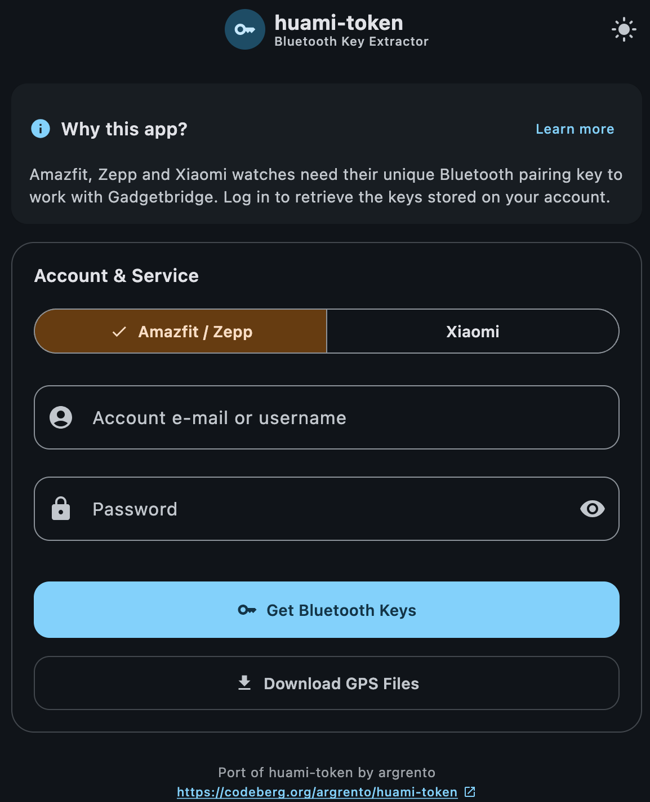
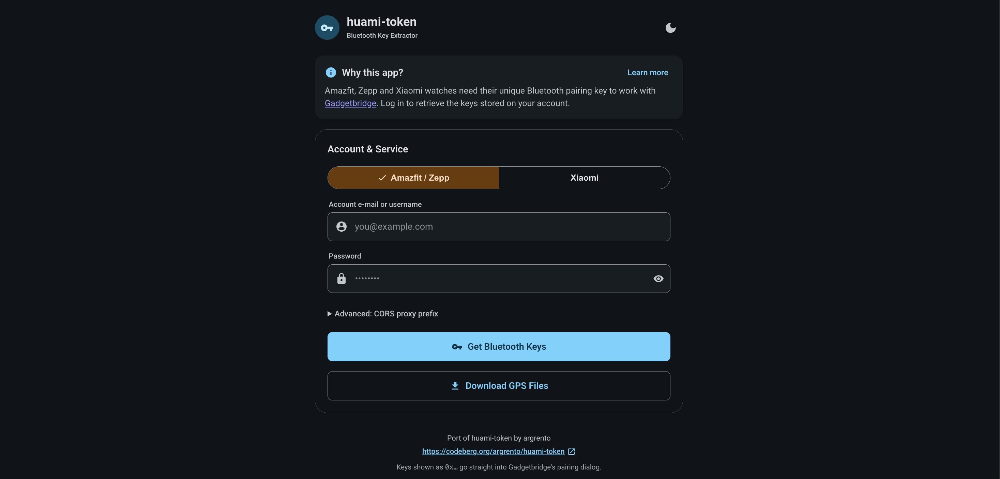
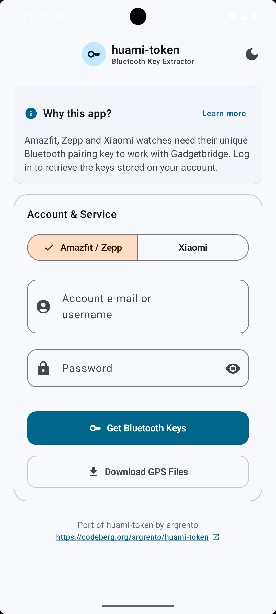
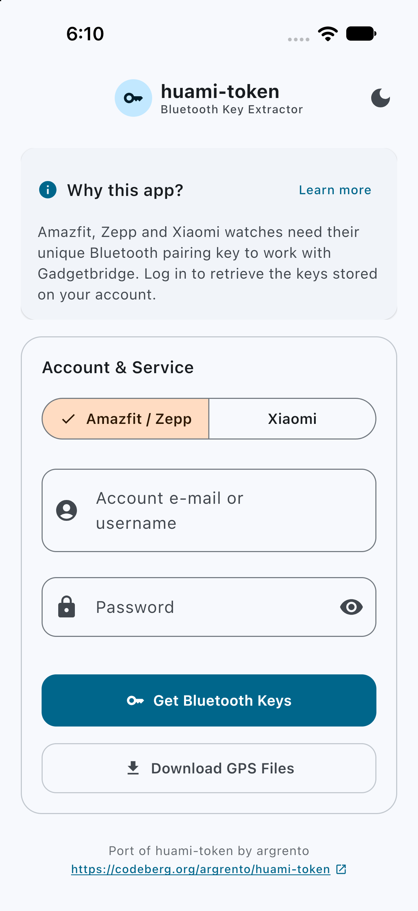

# huami-token — Kotlin Multiplatform port

Kotlin Multiplatform port of [huami-token](https://codeberg.org/argrento/huami-token/). It logs in to Zepp (Amazfit)
or Xiaomi Mi Fitness servers and retrieves the Bluetooth pairing keys of bound watches/bands, for use with Gadgetbridge.

## Homebrew

The CLI can be installed from the custom tap at
`https://github.com/SubhrajyotiSen/homebrew-repo`:

```bash
brew tap SubhrajyotiSen/repo
brew install huami-token
```

## Screenshots

| Desktop | Web |
|:---:|:---:|
|  |  |

| Android | iOS |
|:---:|:---:|
|  |  |

## Modules

| Module | Target | Build system |
|---|---|---|
| `shared-core` | KMP library (JVM, Android, iOS, JS) | Kotlin Toolchain |
| `shared-ui` | KMP Compose UI (JVM, Android, iOS, JS) | Kotlin Toolchain |
| `cli` | JVM console app | Kotlin Toolchain |
| `web` | Browser (Kotlin/JS) | Gradle |
| `serverlessProxy` | Node.js / Vercel (Kotlin/JS) | Kotlin Toolchain |
| `androidApp` | Android app | Kotlin Toolchain |
| `desktopApp` | Desktop (macOS, Windows, Linux) | Kotlin Toolchain (custom plugin) |
| `iosApp/` | iOS (SwiftUI) | Xcode |

## Prerequisites

- JDK 17+
- [Kotlin Toolchain](https://kotlin-toolchain.org/) (auto-provisioned via `./kotlin` wrapper)
- Android SDK for `androidApp`
- Xcode 15+ for iOS framework + `iosApp`

## Build System Notes

This project uses the [Kotlin Toolchain](https://kotlin-toolchain.org/) for most modules, with Gradle retained for the web module and custom Kotlin Toolchain plugins for CLI distribution and desktop native packaging.

### Web module: Why Gradle?

The Kotlin Toolchain's `js/app` product is in incomplete preview. While it compiles Kotlin/JS code to `.klib` intermediate files, the `linkJs` task that converts these to browser-executable JavaScript (`.mjs`) does not produce output. This means `kotlin build --module web` succeeds but generates no deployable artifacts.

Gradle's Kotlin/JS plugin handles the complete pipeline: compile → link → webpack bundle → browser-distributable output (`index.html` + `huami-token-web.js`). Until the Kotlin Toolchain's JS linker is fully functional, Gradle remains the only reliable way to produce the web bundle.

The web build command is:
```bash
./gradlew :web:jsBrowserDistribution   # → web/build/dist/js/productionExecutable/
```

### CLI module: Custom zip distribution plugin

The Kotlin Toolchain's `package` command for `jvm/app` produces only an executable JAR, not a zip distribution with launcher scripts like Gradle's `distZip`. To bridge this gap, the project includes a custom Kotlin Toolchain plugin (`plugins/cli-package/`) that:

1. **Collects runtime JARs** — Copies all dependencies and the module JAR into a `lib/` directory.
2. **Creates launcher scripts** — Generates a shell script (`bin/cli`) and a Windows batch file (`bin/cli.bat`) that run the app with the correct classpath.
3. **Packages a zip** — Produces `cli/build/distributions/cli-<version>.zip` ready for distribution.

The plugin reads the version from `gradle.properties` and is invoked via:
```bash
./kotlin do packageCli --module cli
```

### Desktop module: Custom jpackage plugin

The Kotlin Toolchain's `package` CLI supports only built-in formats (`jar`, `executable-jar`, `aab`, `maven-central-bundle`). It does not support Compose Desktop's native installer formats (`.dmg`, `.msi`, `.deb`) that Gradle's Compose Desktop plugin provides.

To bridge this gap, the project includes a custom Kotlin Toolchain plugin (`plugins/desktop-package/`) that:

1. **Invokes `jpackage`** — The JDK 17+ native packaging tool that creates platform-specific installers.
2. **Filters formats by OS** — macOS produces `.dmg`/`.pkg`, Windows produces `.msi`/`.exe`, Linux produces `.deb`/`.rpm`.
3. **Stages runtime JARs** — Copies all classpath JARs to a temporary directory for `jpackage` to bundle.
4. **Copies artifacts** — Moves final installers to `desktopApp/build/packages/` for predictable CI paths.

The plugin is enabled in `desktopApp/module.yaml` and invoked via:
```bash
./kotlin do packageDesktop --module desktopApp
```

This approach replaces the Gradle Compose Desktop plugin's `packageReleaseDmg`/`packageReleaseMsi`/`packageReleaseDeb` tasks with a single cross-platform command.

### Version management

The project version is defined in `gradle.properties` as `VERSION_NAME`. The desktop packaging plugin reads this value at build time, so the installer version always matches the project version. To bump the version, update `gradle.properties` — the desktop plugin and Android module should be kept in sync with it.

## Commands

```bash
# Build all modules
./kotlin build

# Run tests
./kotlin test

# CLI
./kotlin run --module cli --args="-m amazfit -e you@example.com -p secret --bt_keys"
./kotlin build --module cli
./kotlin do packageCli --module cli   # → cli/build/distributions/cli-<version>.zip

# Web (uses Gradle — see Build System Notes below)
./gradlew :web:jsBrowserDistribution   # → web/build/dist/js/productionExecutable/

# Serverless Proxy
./kotlin test --module serverlessProxy

# Android
./kotlin build --module androidApp
./kotlin run --module androidApp

# Desktop (uses custom jpackage plugin — see Build System Notes below)
./kotlin run --module desktopApp
./kotlin do packageDesktop --module desktopApp   # creates .dmg/.msi/.deb in desktopApp/build/packages/

# iOS (needs Xcode)
# Open iosApp/iosApp.xcodeproj in Xcode and run on a simulator or device.
```

CLI flags mirror the Python tool: `-m {amazfit,xiaomi}` (required),
`-e/--email`, `-p/--password` (prompted when missing), `-b/--bt_keys`,
`-g/--gps` (Amazfit: downloads archives + builds `gps_uihh.bin`),
`-n/--no_logout`.

iOS wiring: Open `iosApp/iosApp.xcodeproj` directly in Xcode. Build the shared framework with `./kotlin build --module shared-core` and `./kotlin build --module shared-ui` before opening Xcode.

## Web, CORS & Serverless Proxy

Browsers enforce Same-Origin Policies (SOP) and restrict access to HTTP response cookies (`Set-Cookie`). Because upstream Zepp/Amazfit and Xiaomi authentication endpoints do not send permissive CORS headers, direct client-side browser requests are blocked. Furthermore, standard browser `fetch` calls cannot access the `Set-Cookie` headers containing `serviceToken` required for Xiaomi authentication.

To eliminate these browser limitations and maximize utility across web environments, this project includes a standalone Node.js serverless proxy route (`api/proxy.js`):

- **Amazfit / Zepp Login:** Direct client requests or proxy routing handle token exchanges.
- **Xiaomi Login:** Fully functional when routed through the serverless proxy, which extracts and forwards authentication cookies (`serviceToken` via `x-received-cookies` / `X-Cookie`).
- **Custom CORS Proxy Support:** The web client UI provides an *Advanced → CORS proxy prefix* field for specifying a custom proxy URL if not using the built-in route.

### Proxy protocol (JSON envelope)

`api/proxy.js` is not a transparent HTTP proxy. The browser sends `POST /api/proxy` with a JSON body
`{url, method, headers, cookies, bodyBase64, followRedirects}`. The function performs the request with
`redirect: "manual"` and always answers with HTTP 200 + JSON `{status, headers, location, setCookies[], bodyBase64}`.
Redirect statuses (e.g. Zepp's `303`) and every `Set-Cookie` value therefore arrive as plain data that the
browser can't rewrite. Only headers listed in the envelope are forwarded. Proxy-level failures return
`{error, stage}` (`400` malformed, `403` host not allowed, `502` fetch failed, `504` timeout). Only
`*.huami.com`, `*.amazfit.com`, `*.zepp.com`, `*.xiaomi.com` and `*.mi.com` are allowed as targets.

### Limits that can't be fixed in code

If Zepp/Xiaomi block datacenter IPs or require a captcha / 2FA, the web app shows the real upstream status
(e.g. `403`/`429`). In that case use the CLI, Desktop, Android or iOS app, which connect from your own IP.

## Vercel Deployment

The project is preconfigured with `vercel.json` to deploy the single-page web application alongside the zero-dependency standalone Node.js serverless proxy (`api/proxy.js`). The web module is built with Gradle, as the Kotlin Toolchain's JS linker does not yet produce browser-distributable output (see Build System Notes).

### Build and Route Architecture (`vercel.json`)

```json
{
  "buildCommand": "./gradlew :web:jsBrowserDistribution",
  "outputDirectory": "web/build/dist/js/productionExecutable",
  "rewrites": [
    {
      "source": "/api/proxy",
      "destination": "/api/proxy.js"
    }
  ]
}
```

- **Static Web Frontend:** Compiled from the `web` module via Gradle to `web/build/dist/js/productionExecutable` (serving `index.html` and `huami-token-web.js`).
- **Serverless API Function:** Executed directly from `api/proxy.js` on Node.js, handling `/api/proxy?url=...` for CORS and cookie forwarding.

### Deployment

#### Deploy via Vercel CLI

1. Install Vercel CLI:
   ```bash
   npm install -g vercel
   ```
2. Deploy:
   ```bash
   vercel          # preview
   vercel --prod   # production
   ```

#### Deploy via Vercel Git Integration

1. Push the repository to GitHub, GitLab, or Bitbucket.
2. Import the project in the [Vercel Dashboard](https://vercel.com/new).
3. Vercel automatically applies `vercel.json`, running `./gradlew :web:jsBrowserDistribution` to compile the web interface and executing `api/proxy.js` to deliver full multiplatform functionality.

## Credits & Attribution

This project is a Kotlin Multiplatform port of the original [huami-token](https://codeberg.org/argrento/huami-token) tool by **argrento**.
All credit for the reverse engineering of the Huami/Zepp and Xiaomi authentication protocols, endpoints, and token generation belongs to the original project and its contributors.
