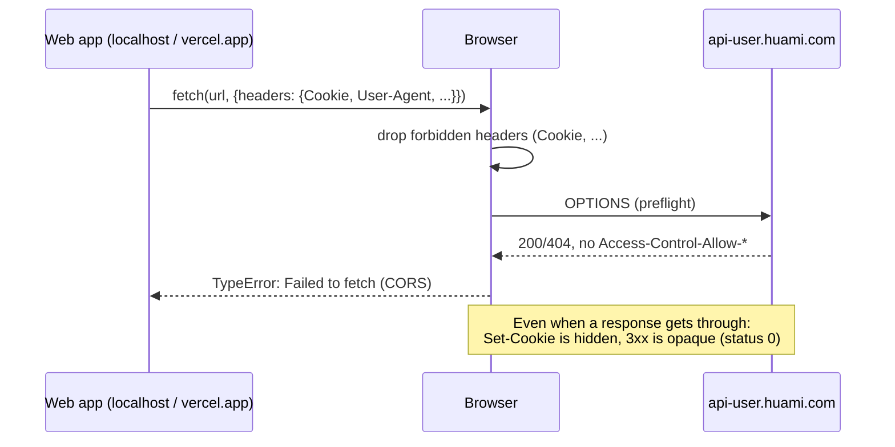
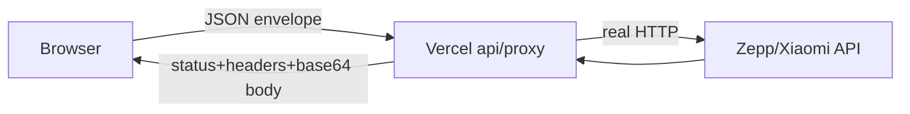

# One codebase, five targets, and the browser says no: CORS in Kotlin Multiplatform

`huami-token-kmp` is a small Kotlin Multiplatform tool. It logs into Zepp/Amazfit or Xiaomi accounts and fetches the Bluetooth auth keys for your wearables. The networking, crypto and login flow all live in `:shared`, and that same code ships as:

- a CLI (JVM),
- a Compose Desktop app,
- an Android app,
- an iOS app,
- a web app (`:web`, Kotlin/JS).

Four of these worked on the first try. The fifth, the browser, didn't, and fixing it took six commits. This post goes through what broke, why it breaks for anyone in a similar setup, and each attempt up to the one that worked.

## The problem

Every platform has an `actual` implementation of a tiny `HttpEngine`. On JVM/Android/iOS it wraps the native HTTP stack. On JS it wraps `fetch`. Here is the original browser version (`shared/src/jsMain/kotlin/org/huamitoken/PlatformJs.kt`, before `18cab46`):

```kotlin
actual suspend fun request(
    method: String,
    url: String,
    query: List<Pair<String, String>>,
    headers: Map<String, String>,
    cookies: Map<String, String>,
    body: ByteArray?,
    followRedirects: Boolean,
): HttpResult {
    var fullUrl = proxyPrefix + url
    // ...
    val init = js("{}")
    init.method = method.uppercase()
    init.redirect = if (followRedirects) "follow" else "manual"
    val jsHeaders = js("{}")
    for ((k, v) in headers) jsHeaders[k] = v
    if (cookies.isNotEmpty()) {
        // Note: browsers forbid setting Cookie via fetch; Xiaomi login needs
        // these cookies, so use Android/iOS/CLI for Xiaomi or a same-origin backend.
        jsHeaders["Cookie"] = cookies.entries.joinToString("; ") { "${it.key}=${it.value}" }
    }
    init.headers = jsHeaders
    if (body != null) init.body = body.toUint8Array()

    val response: dynamic = js("fetch(fullUrl, init)").unsafeCast<Promise<dynamic>>().await()
    // ...
    val location: String? = response.headers.get("location") as? String
    if (location != null) respHeaders["Location"] = location
    // Set-Cookie is a forbidden header in browsers and never visible here.
    return HttpResult(status, bytes, respHeaders, emptyMap())
}
```

The two comments in that code already point at the problem. The contract `HttpEngine` promises to common code is:

1. send arbitrary headers, including `Cookie` and `User-Agent`;
2. don't follow redirects when asked, and return the `Location` header;
3. return every `Set-Cookie` value, so the login flow can carry `serviceToken` to the next request.

The browser breaks all three. On top of that, the first call to `https://api-user.huami.com/...` from `http://localhost:8080` never got past the browser:

```
Access to fetch at 'https://api-user.huami.com/registrations/...' from origin
'http://localhost:8080' has been blocked by CORS policy: Response to preflight
request doesn't pass access control check: No 'Access-Control-Allow-Origin'
header is present on the requested resource.
```

## Why this happens (and why it isn't specific to this project)

Native HTTP clients act for the *user*. A browser `fetch` acts for a *web page*, and the browser assumes the page could be hostile. That leads to a few rules you don't see on native targets. Any SPA, Kotlin/JS or Wasm target, or Flutter/React Native web build that calls an API it doesn't control runs into them.

**1. Same-origin policy and CORS.** A page can only read a cross-origin response if the server agrees by sending `Access-Control-Allow-Origin`. Mobile and IoT backends like Zepp's and Xiaomi's are built for native apps, so they never send it.

**2. Preflight.** A "non-simple" request (custom headers, a `Content-Type` other than form/text/multipart, or methods like `PUT`/`DELETE`) first triggers an `OPTIONS` request. If the server doesn't answer with matching `Access-Control-Allow-Methods`/`-Headers`, the real request is never sent.

**3. Forbidden request headers.** Scripts can't set `Cookie`, `Host`, `Content-Length`, `Origin`, `Referer` and others. `User-Agent` used to be forbidden too, and some browsers still drop or override it. `fetch` ignores these silently, without an error.

**4. Response headers you can't read.** `Set-Cookie` is never exposed to JS, whatever CORS headers the server sends. Other headers are hidden unless they are listed in `Access-Control-Expose-Headers`.

**5. Opaque redirects.** With `redirect: "manual"`, the browser doesn't give you the 3xx. You get an `opaqueredirect` response with `status == 0` and no `Location`. If you follow redirects instead, any cookies set along the way end up in the browser's cookie jar (if anywhere), not in your code.



The takeaway: **you can't fix this on the client.** No `fetch` option turns these rules off. Something you control has to stand between the browser and the API. What's less obvious is that the *shape* of that middle layer matters a lot.

## The attempts

### Attempt 1: call the APIs directly

The first version above. It failed at preflight. With a public CORS proxy prefix (the `proxyPrefix` field) the requests got through, but Xiaomi login still couldn't work: the `serviceToken` cookie arrives in `Set-Cookie`, and the browser never exposes that header. The UI even had a "Browser Limitation" banner saying so.

### Attempt 2: our own pass-through proxy on Vercel (`18cab46`)

*"Rework web target to use a serverless function."* The web app is already deployed to Vercel, so a function at `/api/proxy` on the **same origin** gets rid of CORS for the browser→proxy hop. The proxy then makes the real request from Node, where none of the browser rules apply.

The proxy was first written in Kotlin/JS as its own module (`serverlessProxy/.../ProxyHandler.kt`, exported with `@JsExport`), with a standalone `api/proxy.js` deployed next to it:

```kotlin
@OptIn(ExperimentalJsExport::class)
@JsExport
fun handler(req: dynamic, res: dynamic): Promise<Unit> {
    return Promise { resolve, reject ->
        proxyScope.launch {
            try {
                handleProxyRequest(req, res)
                resolve(Unit)
            } catch (e: Throwable) {
                sendError(res, 500, "Internal Server Error: ${e.message}")
                // ...
```

The design was a *transparent* proxy: `GET|POST /api/proxy?url=<target>`, forward the incoming method, headers and body, and copy the upstream status, headers and body back. Cookies came back to the browser in custom headers such as `x-received-cookies`.

It still failed. A transparent proxy goes **through** the browser, so every browser rule still applies to the browser→proxy request.

### Attempt 3: preflight and header fixes (`70d98cc`)

*"Fix CORS error."* Preflights were still failing, and the `?url=` value got mangled when the target URL had its own query string. The fixes:

- send the target in an `X-Target-URL` header and check it before `?url=`;
- `encodeURIComponent` the target when using the `?url=` form;
- add `x-location` to `Access-Control-Expose-Headers`, because `Location` from a manual redirect isn't readable;
- send cookies twice, as `Cookie` (which the browser drops) **and** `X-Cookie` (which it allows).

```kotlin
if (proxyPrefix.isNotEmpty()) {
    jsHeaders["X-Target-URL"] = targetUrl
    if (proxyPrefix.endsWith("?url=") || proxyPrefix.endsWith("&url=")) {
        val encodedTarget = js("encodeURIComponent(targetUrl)").unsafeCast<String>()
        fullUrl = proxyPrefix + encodedTarget
    } else {
        fullUrl = proxyPrefix + targetUrl
    }
}
```

This is where a pattern started: **each forbidden header gets an `X-` shadow header that the proxy turns back into the real one.**

### Attempt 4: HTTP 400 Bad Request (`984b622`)

Requests now reached Zepp, and Zepp answered `400`. There were two causes:

- `User-Agent` was the browser's, not the app's, so it now goes as an `X-User-Agent` shadow header;
- Vercel's body parser had *already parsed* the form-encoded login body into an object. The proxy then re-serialised it, and the bytes changed. The fix was to turn the parser off:

```js
module.exports.config = {
    api: {
        bodyParser: false,
    },
};
```

### Attempt 5: binary bodies and content type (`b8813cf`)

*"Fix binary body forwarding and content-type handling."* Some endpoints take binary or non-UTF-8 bodies, and the platform still interfered based on `Content-Type`. So the client sent the body as `application/octet-stream` and moved the real content type into another shadow header:

```kotlin
if (k.equals("content-type", ignoreCase = true)) {
    jsHeaders["X-Content-Type"] = v
}
// ...
if (body != null) {
    // Prevent serverless platforms from auto-parsing binary bodies as form text
    jsHeaders["Content-Type"] = "application/octet-stream"
}
```

There were now four shadow headers (`X-Target-URL`, `X-Cookie`, `X-User-Agent`, `X-Content-Type`), and every one also had to be listed in `Access-Control-Allow-Headers`.

### Attempt 6: hop-by-hop and edge headers (`3122c12`)

The proxy forwarded *all* incoming headers except a small skip-list. That meant Vercel's own edge headers (`x-vercel-*`, `x-forwarded-*`, `x-real-ip`), the browser's `sec-*` fetch metadata and `priority`, and hop-by-hop headers like `transfer-encoding` all reached Zepp. The upstream server didn't like it:

```js
function shouldSkipHeader(name) {
    const lower = name.toLowerCase();
    if (HOP_BY_HOP_HEADERS.has(lower)) return true;
    if (lower.startsWith('x-forwarded-')) return true;
    if (lower.startsWith('x-real-')) return true;
    if (lower.startsWith('x-vercel-')) return true;
    if (lower.startsWith('sec-')) return true;
    // ...plus every X-* shadow header
```

Each fix worked, but the approach itself was wrong. Every header passed through **two** HTTP stacks (the browser's and the platform's) that both felt free to add, drop or rewrite things. Redirects were still awkward, and multiple `Set-Cookie` values squashed into one comma-joined header broke on cookies whose `Expires=Wed, 01 ...` contains a comma.

## What worked: a JSON envelope RPC (`6329fd9`)

*"Switch web proxy to JSON envelope RPC protocol."* The fix was to stop pretending the proxy is an HTTP proxy. The browser sends the request **as data**:



- **Request:** `POST /api/proxy` with `Content-Type: application/json` and `{url, method, headers, cookies, bodyBase64, followRedirects}`.
- **Response:** always HTTP `200` with `{status, headers, location, setCookies[], bodyBase64}`.
- **Proxy failures** are separate from upstream failures: `{error, stage}` with `400` (malformed), `403` (host not allowed), `502` (fetch failed), `504` (timeout).

From the browser's point of view this is one boring same-origin JSON POST. `Cookie`, `User-Agent`, a binary body, a `303` status, five `Set-Cookie` values: these are all just JSON fields now, and the browser has no reason to touch them.

The client side (`PlatformJs.kt`) got simpler, since all the shadow-header code is gone:

```kotlin
val envelope = js("{}")
envelope.url = targetUrl
envelope.method = method.uppercase()
val envHeaders = js("{}")
for ((k, v) in headers) envHeaders[k] = v
envelope.headers = envHeaders
val envCookies = js("{}")
for ((k, v) in cookies) envCookies[k] = v
envelope.cookies = envCookies
if (body != null && body.isNotEmpty()) envelope.bodyBase64 = body.toBase64()
envelope.followRedirects = followRedirects
// ...
val status = (json.status as Number).toInt()
val location = json.location as? String
if (location != null) respHeaders["Location"] = location
val setCookies = json.setCookies
if (setCookies != null && setCookies != undefined) {
    val arr = setCookies.unsafeCast<Array<String>>()
    for (sc in arr) parseSetCookie(sc)?.let { (k, v) -> respCookies[k] = v }
}
return HttpResult(status, bytes, respHeaders, respCookies)
```

`HttpEngine`'s contract is met again: real status codes, a real `Location`, every cookie. Common code didn't change at all.

On the server, `api/proxy.js` always uses `redirect: 'manual'` and follows redirects itself when asked, so it keeps cookies from every hop. `getSetCookie()` returns the cookies as a proper array instead of a comma-joined string:

```js
response = await fetchImpl(url, { method, headers, body, redirect: 'manual', signal: controller.signal });
// ...
const setCookies = getSetCookies(response.headers);
allSetCookies.push(...setCookies);
const location = response.headers.get('location');
const isRedirect = response.status >= 300 && response.status < 400 && location;
if (reqSpec.followRedirects && isRedirect && hop < MAX_REDIRECTS) {
    url = new URL(location, url).toString();
    // 303 (and 301/302 after POST) become GET; merge new cookies into the Cookie header
    // ...
    continue;
}
```

CORS on the proxy shrank to three lines, because there's only one method and one header to allow:

```js
res.setHeader('Access-Control-Allow-Origin', '*');
res.setHeader('Access-Control-Allow-Methods', 'POST, OPTIONS');
res.setHeader('Access-Control-Allow-Headers', 'Content-Type');
```

`vercel.json` pins the function to one region and caps its run time. The upstream fetch has a 12 s timeout:

```json
"regions": ["iad1"],
"functions": {
  "api/proxy.js": { "maxDuration": 15 }
},
```

## Takeaways

**For any browser target calling an API you don't own:**

- [ ] Assume you need a backend hop. You can't turn CORS, forbidden headers, hidden `Set-Cookie` or opaque redirects off from the client.
- [ ] Host the proxy on the **same origin** as the app if you can, so the browser→proxy hop needs no CORS at all.
- [ ] Don't build a transparent proxy if you need cookies, redirects or specific headers. Use **request-as-data** (an envelope or RPC). Headers in a JSON body can't be stripped by the browser or the platform.
- [ ] Base64 the bodies. Never let a platform body parser touch them.
- [ ] Return `Set-Cookie` as an **array**. Joining with commas breaks on `Expires` dates.
- [ ] Handle redirects on the server with `redirect: "manual"`, and keep cookies across hops.
- [ ] Separate proxy errors (`{error, stage}`) from upstream statuses so the UI can tell "proxy broken" apart from "wrong password".
- [ ] Keep it in the platform layer (`actual class HttpEngine`) so common code never knows.

**Security notes.** A request-as-data proxy is basically an open relay, so lock it down:

- **Allowlist target hosts.** `isAllowedHost` only accepts `http(s)` URLs on `huami.com`, `amazfit.com`, `zepp.com`, `xiaomi.com` and `mi.com` (and their subdomains). It checks this on *every redirect hop*, so a redirect can't send the proxy somewhere else (SSRF).
- **Limit everything:** request size (`MAX_BODY_BYTES = 1 MiB`), redirects (`MAX_REDIRECTS = 5`), upstream time (12 s), function time (15 s).
- **Pass credentials through, don't store them.** The proxy never persists credentials or tokens, and responses are `Cache-Control: no-store`. Still, users are sending their passwords through your function. Say so, and let them self-host.
- `Access-Control-Allow-Origin: *` is fine *only* because the proxy uses no ambient credentials (no cookies of its own). If it ever does, restrict the origin.

**Limits code can't fix.** If Zepp or Xiaomi block datacenter IPs or ask for a captcha or 2FA, the envelope just passes the real `403`/`429` back to the user. The web app then suggests the CLI, Desktop, Android or iOS app, which connect from the user's own IP. Sometimes the right answer is that a native target is still the better fit for the job.

